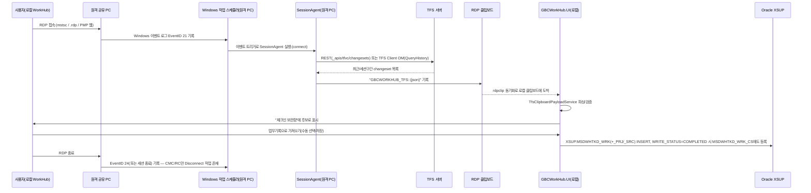

# GBCWorkHub — TFS 수집 & Windows 작업 스케줄러 운영 가이드

> 상위 문서: [GBCWORKHUB_HANDOVER.md](GBCWORKHUB_HANDOVER.md) · 관련 문서: [SITE_ROLLBACK_RUNBOOK.md](SITE_ROLLBACK_RUNBOOK.md)
> 이 문서는 **실제 소스코드(원격 PC에서 실행되는 SessionAgent 포함)와, 조사 시점에 접근 가능했던 로컬 PC(DESKTOP-8FHREA0)의 Windows 작업 스케줄러 상태를 직접 조회**하여 작성했습니다. 운영 환경의 각 사이트 원격 PC(AURORA/CMC/RC 대상 PC)에 직접 접속해 확인한 것이 아니므로, "코드에 등록 로직이 존재함"과 "그 PC에 실제로 등록되어 있고 정상 동작 중임"은 별개입니다. 후자는 반드시 §5의 명령어로 현장에서 재확인하세요.
> 신뢰도 표기: **[코드로 확인됨]** / **[이 PC에서 직접 확인됨]** / **[확인 필요]**

최종 확인일: 2026-10-27

---

## 1. 가장 먼저 알아야 할 것 — "주기적 폴링"이 아니라 "이벤트 트리거"입니다

이 프로젝트의 TFS 자동 수집은 **"매 N분/N시간마다 TFS를 조회하는 배치 작업"이 아닙니다.** 대신:

1. 원격 PC(AURORA/CMC/RC의 공유 PC)에 사용자가 **RDP로 접속/해제할 때마다**, Windows가 보안 이벤트 로그에 EventID **21(세션 로그온 성공)** / **24(세션 연결 해제)** 를 기록합니다.
2. 그 PC에 미리 등록해 둔 **Windows 작업 스케줄러의 "이벤트 트리거(Event Trigger)" 작업**이 해당 EventID 발생을 구독하고 있다가, 이벤트가 찍히는 즉시 SessionAgent 프로그램을 실행합니다.
3. SessionAgent가 TFS 서버에서 최근 체크인 내역을 조회해 **RDP 클립보드**에 적어 로컬 GBCWorkHub(WorkHub)로 전달합니다. (클립보드를 통신 채널로 쓰는 이유와 전체 프로토콜은 `docs/Clipboard_Communication_Reference.md` 참고 — 이 문서는 TFS/스케줄러 운영에만 집중합니다.)

즉 **"TFS 수집용 작업 스케줄러"는 WorkHub를 쓰는 로컬 PC가 아니라, AURORA/CMC/RC의 각 "원격 공유 PC" 안에 등록되어 있습니다.** 인수인계 시 이 구분을 혼동하지 마세요. [코드로 확인됨]

---

## 2. 전체 흐름 (TFS → 수집 프로그램 → 가공 → 저장 → 화면)



**핵심: TFS → DB 저장까지 완전 자동이 아닙니다.** SessionAgent가 클립보드로 내려준 changeset 후보를 사용자가 WorkHub "체크인 보관함" 화면에서 **직접 선택해 업무기록으로 저장**해야 DB(`XSUP.MSDWHTKD_WRK*`)에 들어갑니다. [코드로 확인됨 — `src/GBCWorkHub.BIZ/TfsClipboardPayloadService.cs`, `src/GBCWorkHub.UI/ViewModels/WorkLog/TfsCheckinInboxViewModel.cs`]

---

## 3. 사이트별 TFS 수집 대상 비교

| 항목 | AURORA | CMC | RC | MNGHA |
|---|---|---|---|---|
| TFS 서버/컬렉션 | `http://172.20.0.90:8080/tfs/bestcare2.0b_v1.0` | `http://10.230.35.46:8080/tfs/bestcare_cmc_20191001` | `http://rch-tfs-01:8080/tfs/BESTCare_RCHSP_20170628` | **확인 필요 — 코드/설정 없음** |
| TFVC 서버 경로($/) | `$/HISSolutions` | `$/HISSolutions` | `$/HIS.MS.CS.PH` | — |
| 수집 방식 | TFS Client OM (REST가 404) | REST (프로젝트 스코프 URL 필수) | REST 우선 + OM 폴백 | — |
| 인증 | Windows 통합인증(RDP 로그인 계정) | 전용 계정 `DXBCMC\yang.ss` | 기본 통합인증, 필요 시 전용 계정 | — |
| 계정/비밀번호 저장 위치(해당 원격 PC 로컬) | 없음(통합인증) | `C:\GBCWorkHub\TfsCredential.dat`(DPAPI, 신버전) 또는 `TfsPassword.txt`(평문, 구버전) | 동일(`TfsCredential.dat` 신버전 / `TfsSettings.txt`+`TfsPassword.txt` 구버전) | — |
| 스케줄러 트리거 | EventID 21(Connect)만 | EventID 21(Connect) + 24(Disconnect) | EventID 21(Connect) + 24(Disconnect) | **확인 필요** |
| 등록 스크립트 | `tools/site-setup/Setup_AuroraAgent.ps1` | `tools/site-setup/Setup_CMC.cmd` | `tools/site-setup/Setup_RC_Paste.txt` | 없음 |

**RC 서버 경로 불일치 — 해결됨 [코드로 확인됨]**: 과거 조사 시점에는 RC의 TFVC 경로가 두 값(`$/HIS.MS.CS.PH` vs `$/HISSolutions`)으로 섞여 보였으나, `tools/site-setup/Setup_RC_Paste.txt`에 base64로 내장된 **실제 배포본**을 직접 디코딩해 확인한 결과 **`$/HIS.MS.CS.PH`가 맞는 값**입니다. `$/HISSolutions`는 `tools/agent-updates/GBCWorkHub.SessionAgent/App.config`(어느 사이트에도 실배포되지 않은 미사용 "개선판" 사본, §4 참고)에만 있던 값으로, 실제 배포와 무관한 죽은 설정이었습니다.

**MNGHA는 실시간 TFS 자동 수집 경로가 저장소에 없습니다.** `sql/36_MSDWHTKD_WRK_MNGHA_HISTORY_IMPORT.sql`은 과거 엑셀 수기 이력을 1회성으로 DB에 옮긴 마이그레이션 스크립트이며, 현재 MNGHA에서 SessionAgent를 쓰는지/수기 입력만 하는지는 **확인 필요**합니다.

**사이트 간 영향**: 각 사이트는 서로 다른 TFS 서버·독립된 SessionAgent 설치본을 쓰므로, 한 사이트의 TFS 서버 장애나 SessionAgent 오작동이 다른 사이트의 수집에 직접 영향을 주지 않습니다. 다만 저장 대상 DB(`XSUP.MSDWHTKD_WRK*`)는 전 사이트 공용이므로, **DB 자체 장애는 전 사이트 공통 장애**가 됩니다.

---

## 4. 저장소 안의 SessionAgent 코드가 여러 세대로 공존함 — 반드시 숙지

`tools/` 아래에 TFS 수집 로직이 **서로 다른 세대로 공존**합니다. 2026-10-27 정리로 확실히 죽은 구버전 사본 3개(`tools/Aurora_SessionAgent.ps1`, `tools/CMC_SessionAgent_Program.cs`, `tools/RC_SessionAgent_Program.cs`)는 삭제했지만, 아래 나머지는 여전히 헷갈리기 쉬운 지점이니 숙지가 필요합니다.

| 경로 | 성격 |
|---|---|
| `tools/GBCWorkHub.SessionAgent/` | `.sln`에 등록된 MSBuild 프로젝트. REST 기반(`TfsRecentCollector.cs`), RC 설정값 하드코딩. 2점(connect/disconnect) 파일 변경 추적(`DevSession/`) 포함 |
| `tools/agent-updates/GBCWorkHub.SessionAgent/` | 위 프로젝트의 "개선판" 사본(`.sln` 미등록). 클립보드 재전송 방지(`ClipboardDeliveryState`, TTL 30분/최대 20회), Exact-CAS 복원 추가. 대신 `DevSession/`(2점 추적) 기능은 빠짐. **어느 사이트에도 실배포되지 않은 미사용 사본으로 확인됨**(§3의 RC 경로 혼선도 이 사본의 죽은 설정값 때문이었음) |
| `sql/Aurora_SessionAgent.ps1` | **AURORA의 실제 운영 소스** [확인됨] — `tools/site-setup/Setup_AuroraAgent.ps1`에 base64로 내장된 배포본을 디코딩해 byte-for-byte 동일함을 직접 대조 확인(diff 0줄). AURORA 로직을 고치려면 **이 파일**을 수정해야 함(구버전 `tools/Aurora_SessionAgent.ps1`은 2026-10-27에 삭제됨). |
| `tools/site-setup/Setup_CMC.cmd`, `Setup_RC_Paste.txt` 내부에 base64로 내장된 C# 소스 | **CMC/RC의 유일한 소스**(별도 평문 사본은 2026-10-27에 삭제됨 — 과거 사본은 실제 배포본과 5000줄 이상 차이나는 구버전으로 확인되어 제거). DPAPI 암호화 자격증명, 작업 스케줄러 자동 등록 포함. 배치파일 실행 시 `csc.exe`로 그 자리에서 컴파일됨 — 즉 **이 base64 블록을 고치지 않으면 신규 설치 PC에는 구버전 로직이 그대로 깔립니다.** base64 블록을 고칠 때는 디코딩 → 수정 → 재인코딩 → 블록 치환 절차가 필요합니다(평문 참고 사본이 없으므로 더욱 주의). |

**인수인계 시 반드시 확인할 것 [확인 필요]**: 위 "저장소 안의 소스"가 무엇인지는 이제 확정됐지만, AURORA/CMC/RC 각 사이트의 **운영 중인 원격 PC에 실제로 설치되어 있는 버전**이 최신 소스와 일치하는지는 저장소만으로 확정할 수 없습니다(설치 스크립트를 마지막으로 언제 실행했는지는 현장마다 다를 수 있음). 해당 PC에 RDP로 접속해 `C:\GBCWorkHub\SessionAgent.exe`(또는 `Aurora_SessionAgent.ps1`) 파일의 버전/수정일과 `TfsCredential.dat` 유무를 직접 확인하세요.

**새 로직을 배포하려면**: SessionAgent 소스를 고친 뒤, 해당 사이트의 `Setup_*` 스크립트(CMC/RC는 base64 블록도 함께) 갱신 → 각 원격 PC에서 재실행해야 반영됩니다. 중앙 배포/자동 업데이트 체계는 **없습니다**(원격 PC는 이 앱의 GitHub Releases 자동 업데이트 대상이 아님).

---

## 5. 인증 방식 정리

| 방식 | 사용처 | 비고 |
|---|---|---|
| Windows 통합 인증(Default Credentials) | AURORA(필수), CMC/RC(기본값) | `EnsureAuthenticated()`(OM) 또는 `UseDefaultCredentials=true`(REST). **PAT/OAuth/API Key는 코드 어디에도 없음.** |
| 전용 계정 + DPAPI 암호화 | CMC/RC 신버전 | `ProtectedData.Protect(..., DataProtectionScope.CurrentUser)` → `C:\GBCWorkHub\TfsCredential.dat`. **암호화한 Windows 계정으로 로그인한 상태에서만 복호화 가능** — PC의 Windows 계정을 바꾸거나 재설치하면 이 파일은 못 쓰게 되어 재등록해야 함 |
| 전용 계정 + 평문 파일(구버전) | CMC/RC 구버전 | `C:\GBCWorkHub\TfsPassword.txt`에 비밀번호 1줄. 이 구버전이 실제 운영 PC에 아직 남아있는지 **확인 필요**. 발견 시 DPAPI 버전으로 교체 권고 |

TFS 계정 자체의 비밀번호 값은 이 문서나 어떤 파일에도 기록하지 않습니다 — 필요 시 각 사이트 PC의 `TfsCredential.dat`/`TfsPassword.txt` 현황만 확인하세요.

---

## 6. 데이터 저장 / 중복 방지 / 실패 처리

- **저장 테이블**: `XSUP.MSDWHTKD_WRK`(헤더) + `_PRJ`/`_SRC`(프로젝트/소스 상세) + `_CS`(등록된 changeset 레지스트리, `UNIQUE(SITE_CD, CHANGESET_ID)`). TFS 전용 테이블로 설계됐던 `XSUP.MSDWHTFS`와 그 저장소 `OracleTfsWorkLogRepository`/`TfsWorkLogBiz`는 **코드상 폐기된 no-op**이며(`IsConfigured => false`, `SaveAsync`는 항상 `false` 반환), 실제 저장은 전부 `OracleWorkLogRepository`를 통해 `MSDWHTKD_WRK*`에 들어갑니다.
- **중복 방지**: DB `UNIQUE` 제약은 `MSDWHTKD_WRK_CS`에만 있습니다. 같은 `SITE_CD`+`CHANGESET_ID`로 다시 저장하면, 기존 레지스트리 행을 **먼저 DELETE한 뒤 새로 INSERT**하는 "최종 저장 우선(last-write-wins)" 방식입니다 — 두 사용자가 동시에 같은 changeset을 각각 다른 업무기록으로 저장하면 나중 저장이 이전 것의 소유권을 가져갑니다(명시적 락 없음). `WRITE_STATUS='COMPLETED'`가 아니면(임시저장) 레지스트리에 등록되지 않아, 같은 changeset이 "가져오기 후보"에 다시 나타날 수 있습니다.
- **클립보드 단계의 중복 방지**(DB와는 별개): "개선판" SessionAgent(`tools/agent-updates/...`)는 동일 changeset 묶음을 TTL 30분/최대 20회까지만 재전송 시도하고 이후 포기합니다. 표준판/사이트별 구버전에는 이 로직이 없습니다.
- **실패 처리**: SessionAgent 쪽은 모든 단계가 `try/catch`로 감싸여 실패 시 `C:\GBCWorkHub\Logs\SessionAgent.log` / `SessionAgentError.log`에 기록만 하고 **예외를 삼킵니다**(재시도 없음, 단 클립보드 쓰기만 5회/200ms 재시도). WorkHub(DAC) 쪽도 `catch` 후 `WorkHubFileLogger`에 기록하고 `false`/`null` 반환하는 패턴이며, 자동 재시도나 알림(메일/슬랙 등)은 없습니다.
- **기간 기준**: SYNC_REQUEST(사용자가 명시적으로 "가져오기" 요청)가 있으면 해당 세션 시작~종료 구간, 없으면 로컬 마커 파일(`SessionStartedUtc.txt`) 또는 **최근 8시간** 폴백, 그래도 0건이면 **당일 00:00~현재**(최대 50건)로 재조회합니다.

---

## 7. Windows 작업 스케줄러 — 실제 등록 메커니즘

### 7-1. 이 문서 작성 시점에 로컬 PC(DESKTOP-8FHREA0)에서 직접 조회한 결과 [이 PC에서 직접 확인됨]

```
schtasks /query /fo LIST /v
```
로 전수 조회한 결과, 이 PC(개발자 작업 PC)에는 **TFS 수집용 작업이 없습니다.** 대신 다음 2개가 발견되었습니다 — 이름이 비슷해 혼동하지 않도록 명시합니다.

| TaskName | 실제 용도 | 트리거 | 최근 상태 |
|---|---|---|---|
| `GBCWorkHub-RdpStatus-Test` | `C:\GBCWorkHub\Collect-RdpStatus.ps1` 실행 — **대상 스크립트 파일이 현재 PC에 존재하지 않음**(`C:\GBCWorkHub\`에는 `Logs\` 폴더만 있음). 이름과 달리 TFS와 무관, RDP 상태 수집 테스트용으로 추정 | On demand only(수동 트리거만, 자동 실행 없음) | 마지막 실행 2026-07-27, 결과코드 0. 사실상 **방치된 테스트 작업** |
| `GBCWorkHub_AutoBackup` | `C:\GBCWorkHub_Backups\run_backup.ps1` → 저장소 루트의 `backup_snapshot.ps1` 호출. **TFS와 무관한, 이 프로젝트 소스코드 전체를 타임스탬프 zip으로 로컬(`C:\GBCWorkHub_Backups`)에 백업**하는 개발자 안전망(대규모 리팩터링 전 권장 실행). 7일 보존, bin/obj/packages/.vs 제외 | 매일 18:00 | 정상 작동 중(최근 실행 결과 0) |

**결론**: 이 PC는 WorkHub를 "사용하는" 개발자 PC이지, TFS 수집 대상인 AURORA/CMC/RC의 "원격 공유 PC"가 아닙니다. 따라서 TFS 수집용 스케줄 작업이 없는 것이 정상입니다. **TFS 수집용 작업 스케줄러 실태를 확인하려면, 아래 §7-2 명령어를 각 사이트의 실제 원격 공유 PC에 RDP로 접속해 직접 실행해야 합니다.**

### 7-2. 사이트별로 코드에 등록 로직이 존재하는 작업 [코드로 확인됨]

| 사이트 | 작업 이름 | 트리거 | 실행 명령 |
|---|---|---|---|
| AURORA | `GBCWorkHub_Aurora_SessionAgent` | EventID **21**(세션 로그온 성공)만 | `powershell.exe -STA -NoProfile -WindowStyle Hidden -ExecutionPolicy Bypass -File "C:\GBCWorkHub\Aurora_SessionAgent.ps1" connect` |
| CMC | `GBCWorkHub_CMC_Connect` | EventID **21** | `C:\GBCWorkHub\SessionAgent.exe connect` (`Setup_CMC.cmd` 내장 `RegisterScheduledTask` 함수에서 schtasks.exe /Create /XML로 등록하는 Action 인자를 직접 디코딩해 확인) |
| CMC | `GBCWorkHub_CMC_Disconnect` | EventID **24**(세션 연결 해제) | `C:\GBCWorkHub\SessionAgent.exe disconnect` |
| RC | `GBCWorkHub_RC_Connect` | EventID **21** | `C:\GBCWorkHub\SessionAgent.exe connect` |
| RC | `GBCWorkHub_RC_Disconnect` | EventID **24** | `C:\GBCWorkHub\SessionAgent.exe disconnect` |

- 이벤트 구독 대상 로그: `Microsoft-Windows-TerminalServices-LocalSessionManager/Operational`
- 등록은 전부 `Register-ScheduledTask`(AURORA, PowerShell cmdlet) 또는 `schtasks.exe /Delete` → `/Create /XML`(CMC/RC, `Process.Start`로 호출) 방식입니다.
- 실행 계정: 등록 당시 **로그인해 있던 Windows 사용자**(`InteractiveToken`, `LeastPrivilege`) — 즉 그 PC에 실제 로그인하는 계정 단위로 설치되며, 여러 사람이 같은 PC를 쓰면 **사용자별로 재설치**가 필요합니다.
- 관리자 권한: 설치(등록) 시점에만 필요(UAC 승격). 등록 후 실행 자체는 일반 사용자 토큰으로 동작합니다.
- AURORA는 **Disconnect 작업이 아예 없습니다** — 세션 종료 시점 수집은 설계상 생략되어 있고, 다음 접속(재접속) 시점에 이전 세션분을 모아 전달하는 구조입니다.
- 중복 실행 방지/시간초과/실패 재시도 등 세부 스케줄 옵션(예: `Stop Task If Runs X Hours`)은 코드의 XML 템플릿 기본값을 따르며, **사이트별로 운영 중 수동으로 바꿨는지는 확인 필요** — 현장에서 §7-3 명령으로 직접 조회하세요.

### 7-3. 현장(각 사이트 원격 PC)에서 확인할 명령어

```powershell
# 등록 여부 및 마지막 실행 결과 확인
schtasks /query /tn "GBCWorkHub_Aurora_SessionAgent" /fo LIST /v   # AURORA
schtasks /query /tn "GBCWorkHub_CMC_Connect" /fo LIST /v           # CMC
schtasks /query /tn "GBCWorkHub_CMC_Disconnect" /fo LIST /v
schtasks /query /tn "GBCWorkHub_RC_Connect" /fo LIST /v            # RC
schtasks /query /tn "GBCWorkHub_RC_Disconnect" /fo LIST /v

# 트리거(EventID) 상세 확인 — XML로 내보내서 <Subscription> 확인
schtasks /query /tn "GBCWorkHub_Aurora_SessionAgent" /xml

# 수동 실행 테스트(주의: 실제 TFS 조회 및 클립보드 기록이 발생함)
schtasks /run /tn "GBCWorkHub_Aurora_SessionAgent"

# 설치 파일/버전 확인
Get-Item "C:\GBCWorkHub\Aurora_SessionAgent.ps1" | Select LastWriteTime
Get-Item "C:\GBCWorkHub\SessionAgent.exe" | Select LastWriteTime, VersionInfo
Test-Path "C:\GBCWorkHub\TfsCredential.dat"   # 신버전(DPAPI) 여부
Test-Path "C:\GBCWorkHub\TfsPassword.txt"     # 구버전(평문) 여부 — 있으면 교체 검토
```

### 7-4. 로그 위치 (원격 PC 로컬)

| 파일 | 내용 |
|---|---|
| `C:\GBCWorkHub\Logs\SessionAgent.log` | 매 실행의 BOOT/CONNECT/TFS_COLLECT 등 단계별 로그 |
| `C:\GBCWorkHub\SessionAgentError.log` | 예외 발생 시 스택 트레이스 |
| `C:\GBCWorkHub\LastStatus.json` | 마지막으로 보고한 RDP 상태 스냅샷 |
| `C:\GBCWorkHub\PendingTfsRecent.json` | 아직 전달 못 한 TFS 수집 결과(다음 접속 때 재전송) |

로컬 WorkHub 쪽 로그(수신/저장 확인용): `C:\GBCWorkHub\Logs\WorkHub-yyyyMMdd.log`(개발자 PC 기준 경로, `DiagnosticLogger`/`WorkHubFileLogger` 공용).

---

## 8. 신규 PC 설치 / 환경 복구 절차

### 8-1. 사전 조건 (공통)

- Windows 10/11, 관리자 권한 계정
- .NET Framework 4.8 이상 (csc.exe가 필요한 CMC/RC는 `.NET Framework 4.x` 컴파일러 포함 여부 확인: `%WINDIR%\Microsoft.NET\Framework64\v4.0.30319\csc.exe`)
- AURORA/RC OM 폴백 경로를 쓰려면 TFS Team Explorer(2013, GAC `v4.0_12.0.0.0`) 설치 필요 — **없으면 OM 조회 실패**. 설치 여부는 아래 경로 존재로 확인:
  ```
  C:\Windows\Microsoft.NET\assembly\GAC_MSIL\Microsoft.TeamFoundation.Client\
  C:\Windows\Microsoft.NET\assembly\GAC_MSIL\Microsoft.TeamFoundation.VersionControl.Client\
  ```
- 대상 PC가 TFS 서버(§3의 URL)와 네트워크 경로가 열려 있어야 함(방화벽/VPN)

### 8-2. 사이트별 설치 절차

**AURORA**
1. `tools/site-setup/Setup_AuroraAgent.ps1`을 대상 PC에 복사
2. 관리자 권한으로 PowerShell 실행 → 스크립트 실행(관리자 아니면 자동으로 UAC 승격 재실행)
3. 스크립트가 `C:\GBCWorkHub\Aurora_SessionAgent.ps1` 설치 + `GBCWorkHub_Aurora_SessionAgent` 작업(EventID 21) 자동 등록
4. 계정 입력 불필요(통합인증)

**CMC**
1. `tools/site-setup/Setup_CMC.cmd`를 대상 PC에 복사, **관리자 권한으로 실행**(우클릭 → 관리자 권한으로 실행)
2. 내부적으로 `SessionAgent.exe`를 그 자리에서 빌드 → `setup` 실행 → 콘솔에서 TFS 전용 계정 ID/비밀번호 입력 요청 → DPAPI로 `TfsCredential.dat` 저장 → `GBCWorkHub_CMC_Connect`/`GBCWorkHub_CMC_Disconnect` 작업 자동 등록
3. 설치 완료 후 `Setup_CMC.cmd` 파일은 삭제 권장(스크립트 자체 안내)

**RC**
1. `tools/site-setup/Setup_RC_Paste.txt`를 대상 PC에 `.cmd`로 저장(또는 지시된 방식대로) 후 관리자 권한 실행
2. `SessionAgent.exe` + 별도 설정 헬퍼(`RcSetup.exe` 성격)를 빌드 → 헬퍼가 TFS 계정 입력/DPAPI 저장/`GBCWorkHub_RC_Connect`·`GBCWorkHub_RC_Disconnect` 작업 등록까지 수행
3. 설치 전 **§3의 RC 서버 경로 불일치**를 반드시 운영팀에 확인하고, 필요하면 base64 내장 소스의 `TfsServerPath` 값을 실제 값으로 맞춘 뒤 설치 스크립트를 재생성

**MNGHA**
- 저장소에 설치 스크립트가 없습니다. 신규로 TFS 자동 수집을 구성하려면 AURORA/CMC/RC 중 가장 가까운 패턴(통합인증이면 AURORA 방식, 전용 계정이면 CMC/RC 방식)을 참고해 **새로 작성**해야 하며, 이는 기존 기능 확장이므로 사전 승인 후 진행하세요.

### 8-3. 설치 후 검증

```powershell
schtasks /query /tn "<작업이름>" /fo LIST /v     # Status: Ready, 다음 트리거 대기 확인
# 실제 RDP로 재접속하여 Logs\SessionAgent.log에 CONNECT_* 로그가 찍히는지 확인
# 로컬 WorkHub의 "체크인 보관함"에 changeset 후보가 뜨는지 확인
```

### 8-4. 여러 사용자가 같은 PC를 쓰는 경우

스케줄 작업은 **설치 당시 로그인 계정 단위**로 등록됩니다. 동일 공유 PC를 여러 Windows 계정이 쓴다면, 각 계정으로 로그인한 상태에서 설치 스크립트를 **계정별로 한 번씩** 실행해야 합니다(AURORA 스크립트 주석에 명시).

---

## 9. 장애 유형별 대응 — TFS/스케줄러 관련

자세한 사이트별 롤백/복구는 [SITE_ROLLBACK_RUNBOOK.md](SITE_ROLLBACK_RUNBOOK.md)를 참고하세요. 여기서는 TFS 수집·스케줄러에 국한된 항목만 정리합니다.

### 9-1. 특정 사이트만 TFS 데이터가 수집되지 않음
- **증상**: 특정 사이트(예: CMC)에서만 접속 후 체크인 보관함이 비어 있음
- **원인 후보**: 해당 사이트 TFS 서버 장애/네트워크 단절, `TfsCredential.dat` 만료(DPAPI는 Windows 계정 변경 시 깨짐), 스케줄 작업 비활성화/삭제, GAC(OM) 의존성 손상
- **확인 방법**: 원격 PC에서 §7-3 명령으로 작업 등록 상태 확인 → `SessionAgent.log`/`SessionAgentError.log` 확인 → TFS 서버에 브라우저로 `{CollectionUrl}` 접속 가능한지 확인
- **조치 방법**: 작업이 Disabled면 `Enable-ScheduledTask`, 자격증명 문제면 설치 스크립트 재실행(재등록), 네트워크 문제면 인프라팀 에스컬레이션
- **복구 확인**: 재접속 후 로그에 `TFS_COLLECT_DONE` 기록 확인, 체크인 보관함에 신규 changeset 표시
- **재발 방지**: 해당 PC의 Windows 계정이 바뀌는 작업(재설치/프로필 초기화) 전에는 반드시 재설치 체크리스트에 SessionAgent 재등록 항목 포함

### 9-2. 모든 사이트의 TFS 수집이 동시에 중단됨
- **원인 후보**: 로컬 WorkHub 쪽 수신 로직 문제(각 사이트 서버가 동시에 죽을 확률은 낮음), 또는 Oracle DB 자체 장애(수집은 되는데 저장이 안 되는 것처럼 보이는 경우)
- **확인 방법**: 먼저 Oracle DB 연결 상태(WorkHub 상단 상태 표시, `TestConnectionAsync` 결과) 확인 → DB는 정상인데 전 사이트가 막혔다면 WorkHub 버전/배포 이슈로 좁혀서 §SITE_ROLLBACK_RUNBOOK "배포 이후 기존 기능 동작 안 함" 절차로 이동
- **조치/복구/재발방지**: SITE_ROLLBACK_RUNBOOK.md 참고

### 9-3. 스케줄러는 "성공"으로 표시되는데 데이터가 갱신되지 않음
- **원인 후보**: 작업은 실행됐지만 SessionAgent 내부 로직이 조용히 실패(예외 삼킴) 후 정상 종료 코드(0)를 반환하는 경우가 실제로 가능함(§6 "실패 처리" 참고 — try/catch로 감싸져 있어 스케줄러 입장에서는 "성공"으로 보임)
- **확인 방법**: `schtasks /query ... /v`의 `Last Result`가 0이어도, 반드시 `C:\GBCWorkHub\Logs\SessionAgent.log`의 최신 라인을 열어 `TFS_COLLECT_DONE`/`TFS_COLLECT_EMPTY_WINDOW`/`CONNECT_TFS_FAILED` 중 무엇인지 확인
- **조치**: `CONNECT_TFS_FAILED`면 `SessionAgentError.log`의 예외 메시지로 원인 추적(인증 실패/서버 다운/DLL 누락 등)
- **재발 방지**: "작업 성공=데이터 정상"이 아니라는 점을 운영 체크리스트에 명시(§GBCWORKHUB_HANDOVER.md 체크리스트 참고)

### 9-4. TFS 인증/연결 실패
- **증상**: 로그에 `TFS_OM_AUTH` 실패, HTTP 401/403, 또는 `changesets HTTP failed`
- **확인 방법**: 통합인증 사이트(AURORA)는 해당 Windows 계정이 TFS 접근 권한이 있는지 TFS 관리자에게 확인. 전용 계정 사이트(CMC/RC)는 `TfsCredential.dat` 존재 및 최신 여부, 계정 비밀번호 만료 여부 확인
- **조치**: 계정 문제면 설치 스크립트의 `setup` 재실행으로 자격증명 재입력. 서버 자체 문제면 TFS 서버 담당자 에스컬레이션(이 저장소 범위 밖)

### 9-5. 특정 기간 데이터 누락 / 중복 수집
- §6 "데이터 저장/중복 방지" 로직 특성상, 세션 구간 추정이 어긋나면(예: PC 재부팅으로 `SessionStartedUtc.txt` 유실) 8시간/당일 폴백 범위를 벗어난 체크인은 애초에 조회되지 않을 수 있습니다. 누락이 의심되면 TFS 서버에서 직접 해당 changeset을 확인 후, 체크인 보관함의 "재조회(SYNC_REQUEST)" 기능으로 수동 재수집하거나, 그래도 안 되면 DBA 경유 수동 INSERT를 검토(사전 승인 필요).
- 중복은 §6의 last-write-wins 특성상 "두 번 보이는" 형태가 아니라 "먼저 저장한 쪽의 changeset 소유권이 사라지는" 형태로 나타날 수 있습니다. [SITE_ROLLBACK_RUNBOOK.md](SITE_ROLLBACK_RUNBOOK.md)의 TFS 데이터 롤백 절차를 참고하세요.

---

## 10. 확인 필요 항목 모음 (이 문서 전용)

- ~~RC의 TFVC 서버 경로 `$/HIS.MS.CS.PH` vs `$/HISSolutions` 불일치~~ — **해결됨**(2026-10-27). 배포본 직접 디코딩으로 `$/HIS.MS.CS.PH`가 맞는 값임을 확인, §3/§4 참고.
- MNGHA의 실시간 TFS 수집 경로 존재 여부
- AURORA/CMC/RC 각 사이트 운영 PC에 **실제로 설치된** SessionAgent 버전(구버전 평문 비밀번호 파일이 아직 남아있는지 포함)
- CMC/RC 신버전(`Setup_CMC.cmd`/`Setup_RC_Paste.txt` 내장 base64)의 `connect`/`disconnect` 실행 인자 — 본 조사에서는 등록 함수까지만 디코딩 확인, Action 커맨드라인 전체 문자열까지는 재검증 필요
- 각 사이트 스케줄 작업의 "중복 실행 방지"/"시간 초과"/"실패 시 재시도" 등 세부 옵션이 운영 중 수동으로 변경되었는지
- GAC TFS Client 2013 의존성이 모든 AURORA/RC 원격 PC에 계속 유지되고 있는지(Team Explorer 업그레이드 시 깨질 위험)

---

변경 이력:
- 2026-10-27: 최초 작성 (코드 전수 조사 + 로컬 PC 작업 스케줄러 실측 기반)
- 2026-10-27: 별도 SessionAgent/스케줄러 전담 조사와 교차검증 — CMC Action 커맨드를 "추정"에서 "확인됨"으로 승격
- 2026-10-27: 구버전 죽은 사본 3개(`tools/Aurora_SessionAgent.ps1`, `CMC_SessionAgent_Program.cs`, `RC_SessionAgent_Program.cs`) 삭제에 맞춰 §3·§4·§10 갱신 — RC TFVC 경로 불일치를 실제 배포본 디코딩으로 해결, `sql/Aurora_SessionAgent.ps1`이 AURORA 정식 소스임을 명시
